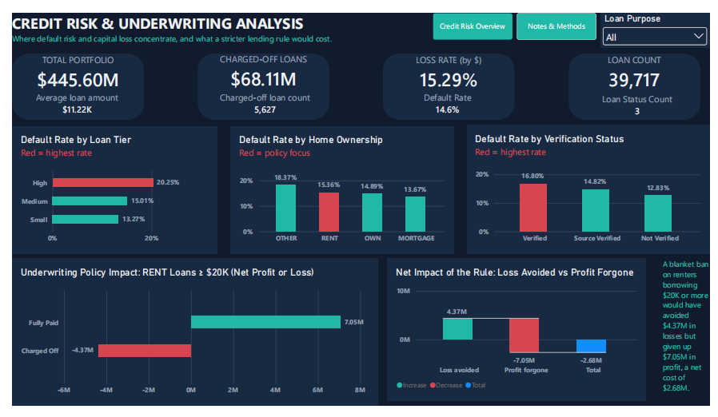

# Fintech Credit Risk & Underwriting Optimization

Fintech credit-risk analytics project using MySQL and Power BI to evaluate historical default patterns, loan-size risk, housing-related risk, verification patterns and the net financial trade-off of a stricter underwriting rule.

## Project Overview

Digital lending portfolios need to balance loan growth with credit risk and financial exposure.

This project analyzes 39,717 historical LendingClub loan records to identify observed risk patterns and evaluate a targeted underwriting scenario using SQL analysis and Power BI.

## Business Problem

The analysis focuses on questions that can support credit-risk monitoring and underwriting decisions:

- Does observed default risk increase with loan size?
- How do housing categories differ in default risk and financial exposure?
- How much loan amount is associated with Charged Off records?
- Does verification status show different observed default patterns?
- What is the net historical trade-off of restricting higher-risk loan segments?

## Objectives

- Analyze observed default rates across loan-size tiers.
- Compare housing categories by loan volume, exposure and default rate.
- Quantify the loan amount associated with Charged Off records.
- Compare default patterns across verification-status categories.
- Measure the net financial outcome of a targeted underwriting restriction (loss avoided vs profit forgone).
- Translate the analysis into an executive Power BI dashboard.

## Business Questions

1. Do larger loans show higher observed default rates than smaller loans?
2. How does housing status relate to observed credit risk and capital exposure?
3. What is the monetary loan amount associated with Charged Off records?
4. How do observed default rates differ by verification status?
5. What is the net historical trade-off of restricting RENT borrowers requesting loans of $20,000 or more?

## Dataset

- Dataset: LendingClub Loan Default Risk Dataset
- Source: (https://www.kaggle.com/datasets/abhipratapsingh/loan-default-risk-analysis-dataset)
- Records analyzed: 39,717
- Primary analytical outcome: Charged Off loan status
- Other loan statuses: Current and Fully Paid

Initial SQL profiling checked record counts, duplicate IDs, missing values and categorical distributions before the business-question analysis.

## Definitions

- **Default rate:** Charged Off loans ÷ completed loans (Charged Off + Fully Paid). Current loans are excluded because their outcome is not yet known.
- **Loss rate (by $):** loan amount associated with Charged Off loans ÷ total loan amount in the portfolio.
- **Loan tier:** based on the requested loan amount.
  - Small: <= $10,000
  - Medium: > $10,000 and <= $20,000
  - High: > $20,000
- **Net outcome:** total payments received minus the amount lent. A positive value is a profit (interest and fees); a negative value is a loss.
- **Loss avoided:** the net loss on Charged Off loans in the restricted segment, i.e. the loss the lender would not have taken.
- **Profit forgone:** the net profit on Fully Paid loans in the restricted segment, i.e. the profit the lender would have given up.
- **Net impact of rule:** loss avoided minus profit forgone. A positive value means the rule would have saved money; a negative value means it would have cost money.

## SQL Analysis

MySQL was used as the primary analytical engine.

The workflow included:

1. Initial data profiling
2. Duplicate and missing-value checks
3. Categorical exploration
4. Loan-size segmentation
5. Housing-risk analysis
6. Portfolio loss/exposure analysis
7. Verification-status analysis
8. Targeted underwriting-policy simulation (net outcome)

## Power BI Dashboard

The Power BI report presents:

- Portfolio KPIs (total portfolio, charged-off amount, loss rate by dollars, default rate, loan count)
- Default rate by loan-size tier
- Default rate by home ownership
- Default rate by verification status
- Loan Purpose slicer
- Underwriting policy scenario for the RENT + >= $20,000 segment: net profit or loss by loan status, and a waterfall of loss avoided vs profit forgone
- A Notes & Methodology page with definitions, findings and limitations

The dashboard is designed to connect descriptive risk analysis with a specific business decision scenario.

## Key Findings

### 1. Default Rates Increased With Loan Size

Observed default rates (completed loans only) increased across the loan tiers:

- Small: 13.27%
- Medium: 15.01%
- High: 20.25%

### 2. Housing Categories Show Different Risk and Exposure Profiles

Mortgage borrowers had the lowest observed default rate at 13.67% but represented more than $224M in loan exposure.

Renters recorded a 15.36% observed default rate and represented a significant share of loan volume. Owners recorded 14.89%.

The OTHER category had the highest rate at 18.37%. <<CHECK: add how many loans are in OTHER; if it is a small group, say so, because the rate is less reliable>>

### 3. Charged-Off Loan Amount Was Significant

Approximately $68.11M in loan amount was associated with Charged Off records, representing roughly 15.3% of total analyzed loan amount.

This figure represents the loan amount associated with Charged Off records; it should not automatically be interpreted as final accounting loss after payments received, recoveries, interest, fees or other adjustments.

### 4. Verification Status Showed an Unexpected Pattern

Verified loans recorded a 16.80% observed default rate compared with 12.83% for Not Verified loans and 14.82% for Source Verified loans.

This is an observed association. It does not establish that verification causes higher default risk. Possible explanations include selection effects or differences in underwriting criteria.

### 5. The RENT + >= $20,000 Segment Had Elevated Historical Risk

The targeted segment recorded a 20.33% historical default rate on completed loans (Charged Off ÷ Charged Off + Fully Paid), compared with a portfolio default rate of 14.6%.

Within the segment:

- Charged Off: 401 loans / approximately $9.88M
- Current: 123 loans / approximately $3.11M
- Fully Paid: 1,571 loans / approximately $37.50M
- Total: 2,095 loans / approximately $50.49M

### 6. A Blanket Restriction Would Have Cost Money

Measured as net outcome (total payments received minus amount lent), the Charged Off loans in the segment lost approximately $4.37M and the Fully Paid loans earned approximately $7.05M.

- Loss avoided: approximately $4.37M
- Profit forgone: approximately $7.05M
- Net impact of the rule: approximately -$2.68M

Although this segment defaults more often than the rest of the portfolio, the profit earned on its repaid loans was larger than the losses on its defaulted loans. Current loans are excluded from this calculation because their outcome is not yet known.

## Underwriting Scenario

The project evaluates the historical trade-off associated with restricting borrowers who:

- Have RENT as their home ownership status
- Requested a loan amount of $20,000 or more

Note: with the tier definitions above, a loan of exactly $20,000 falls in the Medium tier but inside this rule, so the rule segment and the High tier overlap closely but are not identical.

The result shows that a blanket restriction would not have paid off: it would have avoided about $4.37M in net losses but given up about $7.05M in profit, a net cost of about $2.68M. The analysis does not identify an optimal policy. It shows that refusing every borrower in a riskier segment can cost more than it saves.

Potential areas for further evaluation include:

- Risk-based pricing (higher rates for riskier segments)
- Risk-based credit limits
- Additional underwriting criteria
- Enhanced verification requirements

## Recommendations

- Do not apply a blanket restriction to RENT borrowers requesting $20,000 or more; the historical net result was negative.
- Test risk-based pricing or tighter criteria within this segment instead, and evaluate them with data before adopting them.
- Apply greater risk controls to larger loan requests, which showed the highest default rates.
- Investigate the unexpected verification-status pattern.
- Monitor both default rate and financial exposure.
- Establish ongoing monitoring of Charged Off exposure and key risk segments.

## Limitations

- The analysis uses historical observational data and identifies associations rather than causation.
- Findings are based on 39,717 historical loan records and should not automatically be generalized to every lender or current lending environment.
- Charged Off is treated as the default outcome for this analysis. Default rates exclude Current loans.
- Charged-Off loan amount is not necessarily equivalent to final accounting loss.
- The underwriting scenario is a historical look-back on loans that were already approved, not a predictive model. It cannot show how rejected applicants would have behaved or how the lender's mix would have changed.
- The net outcome does not account for the time value of money or the lender's cost of funds.
- Risk rate and financial exposure measure different dimensions of portfolio risk.

## Tools

- MySQL
- MySQL Workbench
- SQL
- Power BI
- DAX

## Project Files

- `loan project.sql`: SQL analysis script
- `Loan Project.pbix`: Power BI report
- `Loan_Dashboard.png`: exported dashboard image
- `Loan_Project_Documentation.docx`: project documentation
- `loan-data.csv` : Dataset

## Outcome

The project demonstrates an end-to-end credit-risk analytics workflow:

SQL profiling → Business-question analysis → Risk segmentation → Financial exposure analysis → Net-outcome policy simulation → Power BI dashboard

## Author

Sofeeyah Adekunle

Data Analyst
